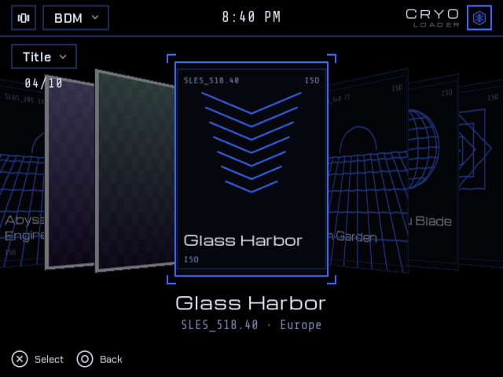
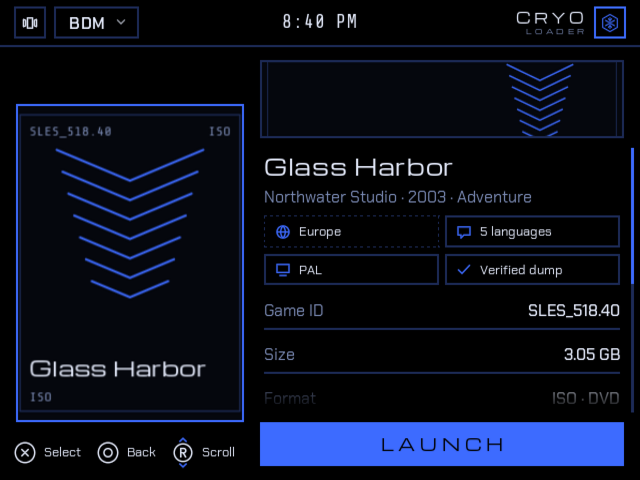
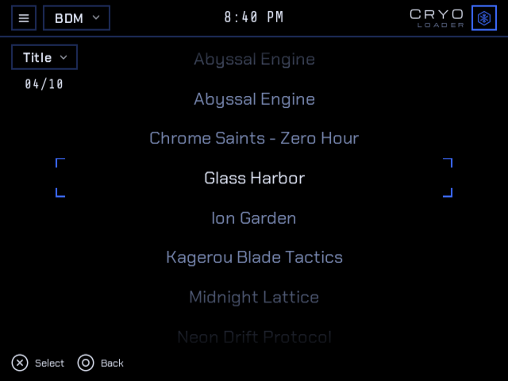
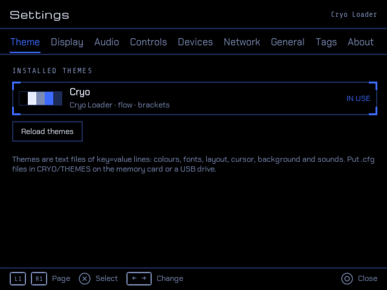

# CRYO Loader

a fun new UX for loading your games on a modded PS2! game loading itself is still stock OPL.

> [!WARNING]
> **CRYO Loader uses your existing `OPL` folder and its settings.** Before you try it, rename that folder to `OPLBAK` (on the memory card, and on any drive you keep one on) so your working OPL setup stays untouched. This is heavily recommended, especially with alpha builds.

| | |
|---|---|
|  |  |
|  |  |

- Cover flow and list views, sorting, and tags read from file names
- A page for each game with its art, details and a one-press launch
- Covers of any size, scaled while they load, and placeholder art for games without one
- 480i or 480p, themes in plain text files, its own sounds and boot screen
- Your own boot sound and background music, set in Settings › Audio

## Build

Build it like OPL: run `make` with the PS2SDK installed. The output is `OPNPS2LD.ELF`; copy it to your memory card or USB drive and start it from uLaunchELF, wLaunchELF, FreeMcBoot or OSDMenu. [CRYO.md](CRYO.md) has the details.

## Credits

- Based on [Open PS2 Loader](https://github.com/ps2homebrew/Open-PS2-Loader) (Academic Free License 3.0, which these changes use too). Its original README is in [README.OPL.md](README.OPL.md).
- Fonts: Chakra Petch, Michroma, Share Tech Mono and IBM Plex, under the SIL Open Font License.
